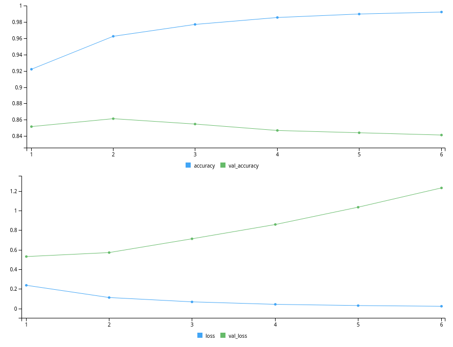
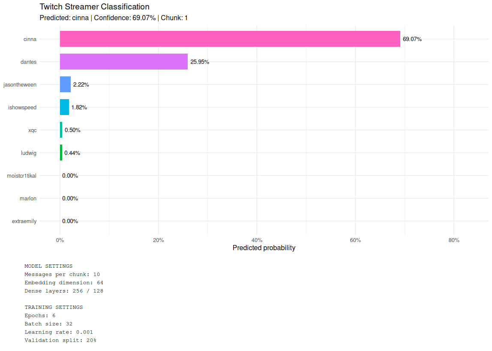
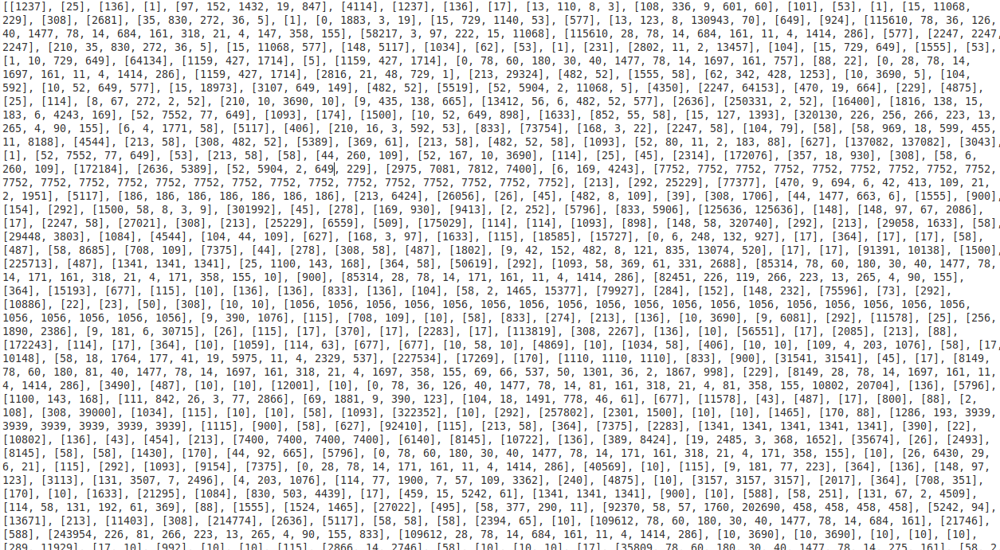

# ML-twitch

A machine learning project for classification for twitch streamers based on the chatters (Neural Network) using the package keras3 in R.



*Figure 1: Training and validation accuracy over 10 epochs for an example with 9 to 21 streams per streamer.*



*Figure 2:  
The example's prediction of the following messages:  
Do you like machine learning?,  
Is coffee or tea better?,   
qjocqcfjjfjccfydfg,  
Good stream,  
Love the content!,  
What is 1 + 2 - ahhhhh asdfasdfasdfasdfasdf,  
YES!,  
Lol,  
hahahahahha,  
what is this?,  
cinema,  
no*



*Figure 3: Tokenization ID rules for this example is in "lookup.csv" not including 0, where 0 is saved for <unk> (unknown words).*


#### Streamers:
  cinna 0,  
  dantes 1,  
  extraemily 2,  
  ishowspeed 3,  
  jasontheween 4,  
  ludwig 5,  
  marlon 6,  
  moistcr1tikal 7,  
  xqc 8  

### If you want to train your own model
Recommended Twitch-chat downloader: 
* "TwitchDownloader" (Copyright (©) lay295).
* Limited use website but best for easy prediction test [twitchchatdownloader](https://www.twitchchatdownloader.com).
* Consider [Twitch TOS](https://legal.twitch.com/en/legal/terms-of-service/) 
	* Section 7: "(d) use of any data mining, robots, or similar data gathering or extraction methods; (e) downloading (except page caching) of any portion of the Twitch Services, the Materials, or any information contained in them, except as expressly permitted on the Twitch Services"
	* Section 10: access any website, server, ... by Twitch, ..., by means of any robot, spider, scraper, crawler, or other automated means for any purpose
	* Section 18: Twitch reserves the right ...  to block or prevent your future access to and use of the Twitch Services for any reason, including without limitation if: (a) your use of the Twitch Services violates these Terms of Service ...  

#### My advice is:
Automate with the help of an AI tool.  
Use [TwitchDownloaderCLI by lay295](https://github.com/lay295/TwitchDownloader) which requires a lot of setup but you can do syncing of VOD (video-on-demand) links with something similar to this excerpt from my automation, using [yt-dlp](https://github.com/yt-dlp/yt-dlp) for extracting the link with:  
```bash
...
yt-dlp --flat-playlist --print "%(url)s" "https://www.twitch.tv/$streamer/videos" > "$temp_file" 2>/dev/null
...
```
and downloading the messages like this excerpt:  
```bash
...
./TwitchDownloaderCLI chatdownload --id 123456789 -o 612942303_chat.json
...
```
* Do not save usernames or permanently store chat messages after training. 

##### Needed:

Find out how to install keras on your device for R, depending on if you have GPU or only CPU. Ask an AI.

```r
install_keras( 
backend = 'tensorflow',
gpu = TRUE
)

install.packages(c( 
"keras3",
"reticulate", 
"jsonlite", 
"stringr", 
"dplyr" 
)) 
```


##### Construct the following folder structure:
* <streamer_name> folders must match the exact streamer names in settings.

./  
└──  Files in this repo.  

./  
└── <streamer_name>/  
    ├── <vod_1>.json  
    └── <vod_2>.json  


Each JSON must contain (where additional keys are allowed in both depths and are ignored):  
{  
  "messages": [  
    {"message": "nerd?"},  
    {"message": "lmfao"}  
    ...  
  ]  
}  

##### Then do as follows:
0. Set "settings.R" as you wish
1. Run "vocabulary.R" 
2. Run "train_model.R" 
3. Run "predict.R" to use the model

Have fun!

### Disclaimer
* Computational efficiency is not regarded, specifically when running "vocabulary.R". 
	* As a test, running "vocabulary.R" for 9 streamers with very active chatters took exactly 14 minutes for single thread on a high end CPU (November, 2026) for streams per streamer as 10, 21, 14, 15, 9, 15, 15, 15, 14.
	* The training maxed out at around 5.5 GiB of R-memory.
* Messages with all words unknown are discarded. Consequently, prediction can receive fewer messages than expected and stop if fewer than a number of `messages_per_chunk` remain (which you type in "settings.R" before running any script).
* If you train the model with  `messages_per_chunk` = 10, then you need at least 10 messages to use "predict.R". 

### Improvements made
No identical stream can end up having chunks in both training and validation. (Reduced data leakage)  

FROM:
* Created chunks
* Shuffle chunks and split 80/20 

TO:
* Training streams -> Training chunks
* Validation streams -> Validation chunks


### Future improvements needed
* Word order within each individual message is lost through the average pooling

